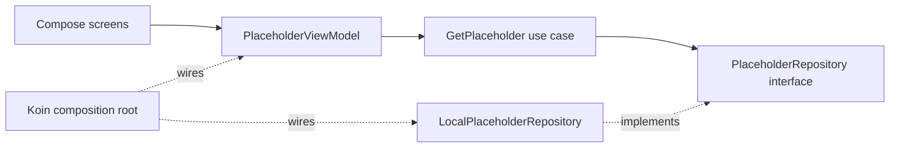

# Shared architecture and navigation

## Repository organization

The Android/iOS hosts and standard KMP source sets retain their existing boundaries. Shared domain/data/presentation packages remain layered, with screens/ViewModels grouped by feature. Original artist inputs now live under `design/`; packaged runtime assets stay in platform assets and Compose resources. Tooling is grouped into assets, balance, validation and testing, with local-only fixtures below testing. Documentation separates feature contracts, backend setup, rendering references, product/design inputs and historical walkthroughs. This avoids additional Gradle modules without a concrete dependency/build need. See [file placement and directory map](PROJECT_STRUCTURE.md) and [documentation index](README.md).

## Multiple SVG companions

PetArtworkRegistry advertises shipped assets, equipment support and story-emotion
capabilities. The six-state renderer is reused by Puppy, Capybara and Rabbit;
shared PetViewModel gates companion facts by capability rather than a Puppy-only
condition. Equipment keeps the existing owner/slot repository contract, while
species-specific SVG profiles attach it to animated head transforms. Inventory
uses common static image resources for locked and unlocked previews. Server XP
and pet_select_species remain authoritative. See COMPANIONS.md.

## Pet dialogue and home widget

PetDialogues and WidgetPetRules are pure commonMain presentation rules; the
resumed Compose dialogue presenter supplies local time and never changes stats.
Android owns the RemoteViews provider, private last-verified display cache and
launcher pinning. CompanionCoordinator updates that cache through authenticated
repositories under its existing owner/generation lock. Widget refresh does not
depend on notification opt-in. The read-only migration 021 RPC computes local-day
quest counts server-side, independently of UTC rewards/streaks. See
[widget and dialogue contract](features/PET_DIALOGUES_WIDGET.md).

## Focus progression

ProgressRepository and ProgressViewModel expose server-verified habit days,
streaks, badges and durable celebration events through StateFlow. Month loads
are revision guarded; successful acknowledgements cannot reappear from stale
responses. The per-user ViewModel store isolates accounts. Migration 020 keeps
awards behind wallet locks and owner-bound RPCs; the ledger trigger grants food
atomically with XP. UTC completion days match reward days. Android owns the
offline reading WebView, lifecycle notification and chime. Compose effects only
project confirmed receipts. See [rules and access controls](features/FOCUS_PROGRESS.md).

## Puppy presentation and server emotion facts

Puppy is a Lv.5 appearance backed by the existing shared progression. Its six
wire states live in PuppyAnimationState/PuppyEmotionRules; the Android
PawQuestDog component bundles the supplied SVG/CSS through the hardened offline
renderer. PetViewModel queues visible four-second Daily celebrations and projects
owner-scoped server facts for missed/completed quests. These facts do not mutate
session eligibility or the reward ledger. Dynamic composition locals track pet,
equipment and room changes inside nested species scenes. A successful species
selection accepts its already-reconciled snapshot without a redundant busy
restore. See [PUPPY.md](features/PUPPY.md) for source assets, priorities and limitations.

## Pet appearance collection

Shared PetSpecies/PetCollection and ManagePet define level-based selection.
PetViewModel exposes collection state and feedback via StateFlow; Inventory and
Pet Home use its presentation controller. Supabase validates XP and saves the
active appearance on the existing pet row, preserving all progression/care.
An allowlisted PetArtworkRegistry maps renderer keys to bundled assets; Android
recreates/releases its offline renderer on asset changes. See [PET_COLLECTION.md](features/PET_COLLECTION.md).

## Hydration and companion reminders

Hydration rules, deadline parsing, icon mood selection and reminder candidates are
pure shared domain code. Supabase repositories supply authoritative pet state and
owner-scoped reminder context. The Android CompanionCoordinator implements local
consent, WorkManager scheduling, daily delivery receipts, launcher aliases and
notification routing through shared presentation interfaces. It never grants
rewards or writes client-selected stats. Owner/generation checks reject stale
work after logout/account changes. See [rules and configuration](features/COMPANION_REMINDERS.md).

## Active 2D presentation (2026-11-06)

The user selected the supplied prototype SVG cat. MainActivity now uses PrototypePetScene: an offline Android SVG renderer driven by the same shared Pet/Equipment/Room state. Compose remains responsible for all application UI and navigation. The older GLB/SceneView sections below describe the retained inactive renderer. See [PROTOTYPE_UI.md](design/PROTOTYPE_UI.md) for security, lifecycle, animation and design decisions.

## Room decoration

RoomFurniture/RoomRepository and PlaceFurniture/StoreFurniture keep fixed-slot
ownership logic in commonMain. InventoryViewModel exposes server-confirmed room
state through LocalRoom; Android loads allowlisted GLBs as static scene siblings,
diffs native models by slot and preserves portrait framing. Migration 013 adds
owned, RLS-protected BED/LAMP/CARPET configuration and idempotent read/set RPCs.
See [ROOM_DECORATION.md](features/ROOM_DECORATION.md) for anchors and resource budgets.

## Equipment customization

EquipmentRepository and equip/unequip use cases live in commonMain. InventoryViewModel
replaces local equip toggles with confirmed, persisted server state and exposes it
to Android through LocalEquipment. Migration 012 validates owned inventory/slot
compatibility and restricts equipment reads with RLS. Android owns GLB loading,
rig-specific node parenting, analytic envelope fitting and resource release. See
[EQUIPMENT.md](features/EQUIPMENT.md) for the inspected non-skeletal cat and replacement rig contract.

## Shop catalog and inventory backend

Shared ItemRepository and InventoryRepository expose authenticated read operations
with rendering-independent domain models; Android supplies Supabase implementations
through Koin. Server inventory owns quantities and uniqueness, with no client write
API. Migration 010 retains Pet Care's food access through a security-invoker view
over the common inventory, avoiding two stock balances. See [SHOP_INVENTORY.md](features/SHOP_INVENTORY.md)
for constraints, private backend primitives and future purchase boundaries.

Migration 011 adds `shop_purchase` and typed shared purchase intent/result models.
ItemRepository.purchase -> PurchaseItem -> ShopViewModel keeps UI state in commonMain.
Only the server calculates charges, serializes wallet updates, grants inventory and
records debit receipts. Successful request UUIDs provide retry idempotency; purchase
ledger rows have no reward day and cannot alter earning caps. ShopViewModel retains
ambiguous pending requests for retry and prevents overlapping commands.

## Pet interactions

Central JSON balance generates shared constants and the server policy migration.
PetRepository returns authoritative snapshots plus typed action outcomes; the
ViewModel manages request identity, feedback and expiring reactions. PostgreSQL
locks/transactions own food consumption, stat validation and sleep reconciliation.
Presentation maps confirmed reactions to animation states. See [care](features/PET_CARE.md).

## Shared pet state

PetRepository/ManagePet/PetViewModel separate persisted pet state from rendering.
The domain contains pure bounded stats and Long XP progression without platform
or rendering dependencies. PostgreSQL owns elapsed-time updates/care and rewards
own XP. An account-scoped StateFlow is projected into Pet Home through a
presentation-only CompositionLocal; SceneView never manages persistent stats.
See [Pet state](features/PET_STATE.md) for lifecycle, policy and migration 008.

## Reward claims

RewardClaimScreen projects server reward offers/receipts from FocusViewModel.
The data adapter uses migration 007's reward_reconcile/reward_claim endpoints;
quotes and grants remain in PostgreSQL, while composables only display values.
Strict duplicate rejection coexists with legacy idempotent RPCs; the immutable
ledger and wallet-row locks guarantee one credit under either API. Lost responses
recover through receipt reads, not local balance increments. See [rewards](features/REWARDS.md).

## Focus sessions

FocusViewModel and ManageFocusSessions coordinate a separate FocusRepository,
using server session snapshots and an injectable monotonic display clock.
Activity lifecycle pauses foreground ticking; resume/process restart reconciles
against PostgreSQL. Focus UI renders state, never grants rewards. Immutable
session snapshots and idempotent RPCs preserve one-active and exactly-once rules.
See [Focus lifecycle](features/FOCUS.md) for recovery, network behavior and migration 006.

## Quest definitions

Shared CreateQuest/UpdateQuest/DeleteQuest/GetQuests use cases validate domain
drafts and depend on QuestRepository. SupabaseQuestRepository maps database
records to domain models and shares the Android Auth client; Koin wires both.
Definitions contain recurrence intent, not execution state. Delete archives
definitions to preserve sessions and reward receipts. Reward previews now live
in domain; server claims remain authoritative. See [Quest decisions](features/QUESTS.md).
QuestViewModel manages list/form/detail state and projects domain reward previews
for Compose. QuestSessionRepository is a separate narrow bridge to the existing
Start RPC and a read-only UTC reward-progress RPC. Quests UI never calls tables
or calculates reward amounts. The same authenticated Android client supplies
both adapters; account-scoped ViewModels are still cleared on sign-out.

## Supabase database foundation

The initial server schema is versioned under `supabase/migrations`. Profiles,
pets, quests, quest sessions, wallets and reward receipts have owner-scoped RLS.
Session start/cancel and explicit reward claims use authenticated, authoritative
database functions. Mobile code must not calculate/grant Coins or XP or directly
write sessions/wallets/receipts. A future shared repository can wrap these RPCs;
the shared authentication repository now wraps Auth and account-readiness RPCs.
Android injects the configured client and encrypted SessionManager; see
[authentication](features/AUTHENTICATION.md) for session lifecycle and the protected gate.
See [database policies and verification](backend/DATABASE.md) for UTC reward days,
exactly-once posting, caps, locking, migration order and reproducible tests.

## Scope

PawQuest uses MVVM and the Repository pattern in the `shared` KMP module.
The shared foundation provides navigation and static placeholders. Android Pet
Home supplies a platform scene through a shared Compose content slot. No quests,
rewards or shop transactions are implemented. Authentication protects the shell;
the Profile account card reads the initialized user's wallet and cat.

## Dependencies and layers

All of these layers live under `shared/src/commonMain/kotlin/com/pawquest`:

| Package | Responsibility | Allowed dependencies |
| --- | --- | --- |
| `domain/model` | Platform-independent data contracts | Kotlin |
| `domain/repository` | Repository contracts | Domain models |
| `domain/usecase` | Application operations | Domain repository contracts |
| `data/repository` | Repository implementations | Domain contracts, future data sources |
| `presentation/navigation` | Destination IDs, icons, bottom scaffold | Compose, presentation, domain models |
| `presentation/placeholder` | ViewModel and observable screen state | Shared Lifecycle, Coroutines, domain use cases |
| `presentation/state` | Reusable sealed UI states | Kotlin |
| `presentation/components` | Loading, error/retry, empty, content UI | Compose, presentation state |
| `di` | Composition root | All layers and Koin |

Domain does not depend on Compose, Koin, Android APIs, or data implementations.
UI never accesses backend tables. Future repositories implement domain contracts;
business rules belong in shared use cases, with backend authority preserved for
rewards and transactions. Android integrations and rendering belong in
`androidMain`; the Android executable owns Activity and manifest configuration.

## Dependency injection and lifecycle

`createAppContainer()` assembles three Koin modules:

- Data binds `PlaceholderRepository` to a singleton `LocalPlaceholderRepository`.
- Domain supplies `GetPlaceholder` through a factory.
- Presentation supplies `PlaceholderViewModel` through a parameterized factory
  receiving a section ID. ViewModels are not application singletons.

Android's `PawQuestApplication` owns the isolated Koin container and passes it
to shared `App`. `viewModel(key = destination.route)` resolves each ViewModel
through Koin only when the lifecycle ViewModelStore needs an instance. The store
retains separate tab ViewModels across tab changes and Activity recreation,
and clears their coroutine scopes when the owner is destroyed permanently.
Previews render the scaffold directly without DI or asynchronous loading.
The optional standalone/iOS `App()` creates and disposes its own container.

`PlaceholderViewModel` exposes read-only `StateFlow<UiState<SectionPlaceholder>>`.
It launches repository work in `viewModelScope`, cancels an earlier request on
retry, propagates coroutine cancellation, and translates other exceptions to a
safe user message. The local repository returns static content immediately;
no artificial delay or fake feature activity is added.

## Navigation policy

Four habit-first `Destination` entries define stable route IDs and display labels:
Home, Quests, Pet Room and Explore. Home (today's progress and next quest) is the
initial destination. Selection is stored with `rememberSaveable` as a route string so
Android saved state can restore it after recreation/process death. Legacy routes from
notifications, widgets and older builds map to the new tabs (`pet_home` -> Pet Room,
`shop` -> Explore, `inventory` -> Pet Room wardrobe, `profile` -> Home); unknown saved
routes fall back to Home. Settings/account and the progress dashboard are bottom sheets
opened from the avatar button and Home's "View progress" link. See
`docs/superpowers/specs/2026-11-13-habit-first-navigation-design.md`. Tapping a tab replaces the visible top-level destination;
reselecting it retains its ViewModel. Tabs do not build a history stack.
Android Back follows the host's normal behavior and leaves the Activity.

A small enum-based switch is sufficient for these five flat placeholders, so no
navigation dependency is added. Introduce a navigation graph when nested flows,
deep links, arguments, or back stacks are required. Destination routes are passed
as section IDs at the presentation/use-case boundary; the data layer's static
catalog is explicitly temporary, not a feature repository implementation.

## Portrait and insets

The existing manifest portrait request and edge-to-edge Activity remain in use.
Material3 `Scaffold` owns the shared bottom bar. Content uses scaffold padding
and consumes its insets once. `NavigationBar` receives horizontal and bottom
safe drawing insets; content receives status bar/cutout safe drawing insets.
The bottom bar is outside scrolling screen content, so long content never pushes
navigation below the viewport.

Each Material3 navigation item provides a standard touch target, selected
semantics, and its full accessible destination name. Labels appear at widths of
at least 360 dp and font scale at most 1.3. Narrower phones or larger fonts show
icons with full accessibility labels to prevent text from clipping. Content
wraps and scrolls independently. No production screen pixel dimensions or
fixed aspect ratio are imposed. Phone previews include 9:16, 19.5:9, and 20:9.

## Reusable state convention

`UiState<T>` is exhaustive: `Loading`, `Content<T>`, `Empty(message)`, and
`Error(message)`. `StateContent` renders each branch with wrapping text,
scrolling, and an explicit retry callback for errors. The placeholder ViewModel
uses the pattern now; future features can adopt it or define richer typed state
when their requirements justify it. Exceptions are not displayed verbatim.

## Validation and extension

`PetAnimationState` is a platform-independent domain enum. Native clip mapping,
playback clock, pose reset, and Filament bone updates are Android presentation
responsibilities owned by the scene. They do not change pet stats or trigger
feature use cases. The controller is disposed before its native model; it is
not an application DI singleton. See [animation contract](rendering/ANIMATIONS.md) for
clip names, fallback policy, debug controls, and fixed all-pose camera framing.

Android Pet Home accepts the platform scene through `App`/`PawQuestScaffold`'s
optional Compose slot. The renderer fills a bounded, inset-aware area outside
the scrolling design-system examples. SceneView, Filament, GLB loading, camera
framing, and native ownership are confined to `androidMain`; native objects are
not stored in shared ViewModels or Koin singletons. See [3D asset and lifecycle
guide](rendering/3D_ASSETS.md) for the generated development cat, replacement instructions,
camera algorithm, and cleanup contract.

Shared tests verify DI resolution for all destinations, repository singleton and
ViewModel factory scopes, content mapping, loading/error/retry/empty transitions,
cancellation, and unknown-route fallback. Emulator checks cover actual tab taps,
compact layouts, tall phone ratios, navigation accessibility bounds, and saved
selection. Actual commands and results are recorded in `IMPLEMENTATION_LOG.md`.

To add a feature, introduce its domain contracts/use cases, data implementation,
ViewModel, and presentation screen, then wire the dependencies in Koin. Replace
its static placeholder without moving business behavior into the Activity or UI.

References: [shared ViewModel lifecycle](https://kotlinlang.org/docs/multiplatform/compose-viewmodel.html)
and [Material3 inset handling](https://developer.android.com/develop/ui/compose/system/material-insets).

## SVG cosmetic catalog expansion

DecorCatalog maps canonical item codes to shared equipment/room slots; ItemArtwork supplies reusable Compose thumbnails. Backend ownership, unique quantities, wallet serialization and slot replacement remain authoritative. Native scene payloads carry validated asset identifiers, allowing multiple variants per slot. Four species use per-rig attachment transforms; fixed furniture anchors split background and foreground. See [DECOR_CATALOG.md](features/DECOR_CATALOG.md).

## Bilingual presentation

The shared localization catalog pairs English/Vietnamese system copy and numbered templates. Display boundaries read the observable AppLocale preference; user-authored quest titles/descriptions and account names bypass translation. Domain values, repositories, RPCs and economic rules retain their canonical values. Android persists language separately from authentication, applies Activity locale configuration, and reads the same preference when rendering widgets or posting reminders. Existing consent and notification deduplication remain intact. See LOCALIZATION.md.

## Offline viewing

`data/offline/OfflineCache` keeps the last confirmed JSON for the account,
pet + wallet (`pet_state`) and the quest list, app-private and cleared on
sign-out or account switch. Repositories return it only for reads when the
network fails or the session cannot refresh, and `ConnectionStatus` drives the
offline banner. Writes (care, purchases, Focus, quest edits) always go to the
server; nothing cached is replayed or used to grant rewards.

## Appearance

`AppAppearance` (Match system/Light/Dark) selects `PawQuestColors()` or
`pawQuestDarkColors()`. Fills are deepened in the dark palette so the light
labels buttons pair with them keep 4.5:1 contrast; `*Dark` accent tokens become
light tints. Pet scenes and illustrated icons keep their artwork colours.

