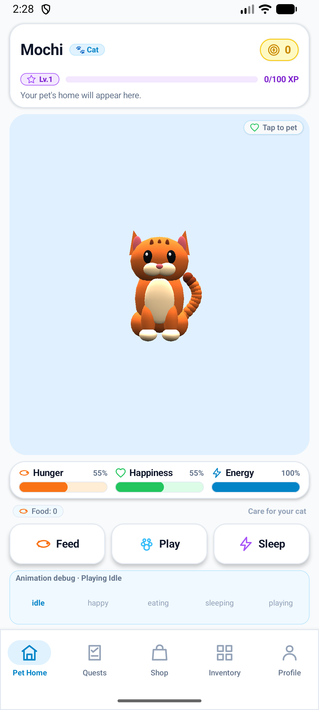

# Walkthrough: PawQuest 3D Portrait Pet Home Screen

PawQuest 3D's first portrait-only 3D Pet Home screen is now fully built and integrated using Compose Multiplatform. Inspired by portrait virtual pet games like *Talking Tom*, the layout delivers a clean, playful, and responsive mobile UI built around PawQuest's white and sky-blue design identity.

---

## Architecture & Layout Structure

The Pet Home screen is implemented in [`PetHomeScreen.kt`](../../shared/src/commonMain/kotlin/com/pawquest/presentation/home/PetHomeScreen.kt) and wired to native 3D rendering in [`PetScene.kt`](../../shared/src/androidMain/kotlin/com/pawquest/presentation/scene/PetScene.kt).

### 1. TOP Area
- **Pet Name & Identity**: Shows `"Mochi"` with a `"🐾 Cat"` pill tag and `"Your pet's home will appear here."` subtitle.
- **Level & Currency Badges**: Features the purple [`PetXpBadge`](../../shared/src/commonMain/kotlin/com/pawquest/presentation/components/PawQuestBadge.kt) (`Lv.2 • 65 XP`) and the gold [`CoinBadge`](../../shared/src/commonMain/kotlin/com/pawquest/presentation/components/PawQuestBadge.kt) (`120 Coins`), both equipped with single-line layout enforcement.

### 2. CENTER: Large Vertical 3D Scene Viewport
- **Visual Focus**: Takes up all available vertical space via `Modifier.weight(1f)`.
- **Cozy Bedroom Atmosphere**: Soft gradient background (`#EFF6FF` to `#E0F2FE`), rounded corners (`24.dp`), and a subtle sky-blue border (`#BAE6FD`).
- **Interactive "Tap to Pet"**: Tapping anywhere in the 3D pet viewport triggers the `HAPPY` animation with an overlay tag in the corner.
- **Platform Separation**: Pure Compose UI slot (`sceneContent: @Composable (Modifier) -> Unit`) in `commonMain`, rendered by [`PetSceneView`](../../shared/src/androidMain/kotlin/com/pawquest/presentation/scene/PetSceneView.kt) using Filament/SceneView in `androidMain`. The existing 3D renderer and camera framing are 100% preserved.

### 3. LOWER AREA: Pet Needs & Action Buttons
- **Needs Indicators ([`PetStatBar.kt`](../../shared/src/commonMain/kotlin/com/pawquest/presentation/components/PetStatBar.kt))**:
  - **Hunger**: 80% (Coral Orange) with Fish icon.
  - **Happiness**: 90% (Emerald Green) with Heart icon.
  - **Energy**: 75% (Sky Blue) with Bolt icon.
- **Tactile Action Buttons**:
  - **Feed**: Feeds the cat (+15 Hunger) and activates `EATING` animation state.
  - **Play**: Plays with the cat (+15 Happiness, -5 Energy) and activates `PLAYING` animation state.
  - **Sleep**: Puts the cat to rest (+20 Energy) and activates `SLEEPING` animation state.
- **Animation Debug Row**: Integrated when `showDebugControls == true` (`BuildConfig.DEBUG`), exposing buttons to switch between `IDLE`, `HAPPY`, `EATING`, `SLEEPING`, and `PLAYING`.

### 4. BOTTOM: Five-Tab Navigation Bar
- Hosted by [`PawQuestScaffold.kt`](../../shared/src/commonMain/kotlin/com/pawquest/presentation/navigation/PawQuestScaffold.kt) across all 5 destinations: **Pet Home**, **Quests**, **Shop**, **Inventory**, and **Profile**.
- Respects system bar insets and safe drawing boundaries.
- Uses `launchMode="singleTask"` for the main activity to ensure reliable task restoration.

---

## Verification & Test Results

### 1. Automated Gradle Tests & Lint
- `.\gradlew.bat :shared:testAndroidHostTest :androidApp:assembleDebug :androidApp:lintDebug`
- **Result**: **BUILD SUCCESSFUL**, 12 tests passed, 0 failures, 0 lint errors.

### 2. Scene Lifecycle & Tab Navigation Smoke (`build/scene-smoke.ps1`)
- **Resolutions Tested**: 960 × 1704 (compact), 1080 × 1920 (9:16), 1080 × 2340 (19.5:9), 1080 × 2400 (20:9).
- **Tab Recreation**: 3 complete cycles leaving Pet Home for Quests and returning.
- **Background / Resume**: State and surface preserved without crashes or native resource leaks.
- **Result**: **PASS** (loaded=6, destroyed=5, 0 errors).

### 3. Animation Smoke Suite (`build/animation-smoke.ps1`)
- **20 Runtime Animation Checks**: Tested `IDLE`, `HAPPY`, `EATING`, `SLEEPING`, `PLAYING` across all 4 portrait resolutions.
- **Background / Resume State Retention**: Verified that the active animation state (`PLAYING`) is retained when returning from launcher.
- **Result**: **PASS** (exit code 0).

### 4. Navigation Smoke Suite (`build/navigation-smoke.ps1`)
- Tested all 5 tabs across all 4 portrait screen dimensions.
- Verified touch targets >= 48dp and safe above system navigation.
- Verified background process kill and state restoration.
- Verified compact 320dp viewport with accessibility font scale 2.0.
- **Result**: **PASS** (exit code 0).
